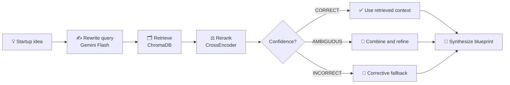
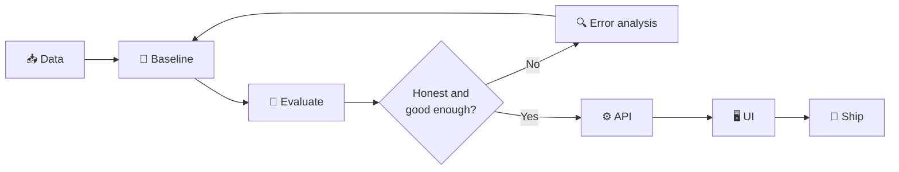

<!--
  SAHIL DESAI — PROFILE README
  Setup: put this file in the root of the PUBLIC repo named `sahil1399m` (branch: main),
  together with the .github/workflows/ folder. Then run both workflows once from the Actions tab.
-->

<div align="center">


<a href="https://git.io/typing-svg">
  
</a>

<br/><br/>

<a href="https://github.com/sahil1399m"></a>
<a href="https://linkedin.com/in/sahil-desai-665404341"></a>
<a href="mailto:sahildesai00112@gmail.com"></a>
<a href="https://instagram.com/sahildesai_012"></a>
<a href="https://leetcode.com/u/SahilDesai012/"></a>

<br/><br/>


<br/><br/>

<a href="#-about-me">ABOUT</a> ·
<a href="#-featured-builds">PROJECTS</a> ·
<a href="#-how-i-build">PROCESS</a> ·
<a href="#-tech-arsenal">STACK</a> ·
<a href="#-github-command-center">ANALYTICS</a> ·
<a href="#-contribution-universe">CONTRIBUTIONS</a> ·
<a href="#-milestones">MILESTONES</a> ·
<a href="#-lets-connect">CONTACT</a>

</div>

<br/>

```text
$ ./boot_sahil.sh
[ OK ] loading python, c++, pytorch ........................ done
[ OK ] mounting retrieval layer (chromadb) ................. done
[ OK ] spawning agents (langgraph) ......................... done
[ OK ] attaching evaluation harness ........................ done
[ >> ] status: shipping practical AI systems — not just demos
```


<div align="center">

## 🧬 About Me

</div>

```text
┌────────────────────────────────────────────────────────────────────┐
│  NAME        Sahil Desai                                           │
│  STUDYING    B.Tech, Electronics & Telecommunication — VJTI Mumbai │
│  FOCUS       AI Engineering • Machine Learning • Computer Vision   │
│  EXPLORING   Deep Learning • RAG • Agentic AI • Cybersecurity      │
│  BUILDING    Practical AI projects, from data pipeline to UI       │
│  MINDSET     Build → Measure → Learn → Improve                     │
└────────────────────────────────────────────────────────────────────┘
```

- 🧠 Building AI-agent systems, RAG pipelines and computer-vision models.
- 🔬 Care about model evaluation, retrieval quality, video understanding and multi-agent workflows.
- 🛠️ Comfortable across the stack: data processing, model logic, APIs and usable interfaces.
- 🛡️ Interested in security too — completed a cybersecurity virtual internship and built an intrusion-detection system.
- 🌱 Sharpening ML, deep learning and DSA fundamentals (C++).
- 🤝 Open to collaboration on applied AI/ML and open-source projects.

<details>
<summary><b>⚡ Easter egg — click to run <code>sahil.py</code></b></summary>

```python
class Sahil:
    role      = "AI/ML engineer in the making"
    stack     = ["Python", "C++", "PyTorch", "LangGraph", "FastAPI", "Streamlit"]
    obsession = ["evaluation", "retrieval quality", "reliable agents"]
    rule      = "Measure before claiming."

    def solve(self, problem):
        data   = self.understand(problem)
        model  = self.prototype(data)
        result = self.evaluate(model)
        return self.ship(result) if result.is_honest else self.iterate(model)
```

</details>


<div align="center">

## 🚀 Featured Builds

<i>Selected projects across RAG, multi-agent systems, computer vision and local-first automation.</i>

</div>

<table>
  <tr>
    <td width="50%" valign="top">
      <h3>🧠 Asterion <sub>(formerly VentureIQ)</sub></h3>
      <p><b>AI Startup Blueprint Generator</b> · 🏆 Lenovo LEAP AI Hackathon 2.0 Finalist</p>
      <p>Corrective RAG pipeline that turns a startup idea into a researched blueprint: query rewriting, ChromaDB retrieval, cross-encoder reranking and confidence-based routing, plus a four-agent AI Mentor.</p>
      <p>
        
        
        
        
        
        
      </p>
      <a href="https://github.com/sahil1399m/startup-blueprint-ai"></a>
    </td>
    <td width="50%" valign="top">
      <h3>🎭 AIthentic</h3>
      <p><b>Video Deepfake Detection</b> · research-style paper by Team CodePagloos</p>
      <p>Video-level face-swap detection using MTCNN face extraction, motion-based frame selection, an EfficientNet-B3 spatial encoder and Bi-LSTM temporal modelling, with Groq-powered explanations, auth and scan history.</p>
      <p>
        
        
        
        
      </p>
      <p><b>96.71%</b> test accuracy <sub>· 152 held-out videos · FF++ C23 + Celeb-DF v2</sub></p>
      <a href="https://github.com/sahil1399m/AI_DEEPFAKE_FINAL_MODEL"></a>
    </td>
  </tr>
  <tr>
    <td width="50%" valign="top">
      <h3>🛡️ SentinelAI</h3>
      <p><b>Network Intrusion Detection + Agentic Investigation</b></p>
      <p>ML detection on CICIDS2017 (XGBoost, Macro F1 ≈ 0.966, plus Isolation Forest for anomalies) feeding a 7-node LangGraph investigation pipeline powered by Llama 3.3 70B on Groq.</p>
      <p>
        
        
        
        
      </p>
      
    </td>
    <td width="50%" valign="top">
      <h3>💸 FinGuard-AI</h3>
      <p><b>Anti-Money-Laundering Detection</b></p>
      <p>AML detection system with a case-management workflow, fraud-ring discovery through graph analysis, and a production architecture designed for IBM Cloud Lite with a PostgreSQL schema.</p>
      <p>
        
        
        
        
        
      </p>
      
    </td>
  </tr>
  <tr>
    <td colspan="2" valign="top">
      <h3>🧾 BillWise Local</h3>
      <p><b>Local-First Invoice Processing</b> — your invoices never leave your machine.</p>
      <p>Invoice extraction and expense management using OCR, local LLM-assisted field extraction, validation rules and SQLite persistence.</p>
      <p>
        
        
        
        
      </p>
      
    </td>
  </tr>
</table>

<details>
<summary><b>🔍 Peek inside Asterion's Corrective RAG flow</b></summary>

<br/>



<sub>Simplified view — the three branches mirror the CORRECT / AMBIGUOUS / INCORRECT routing in the pipeline.</sub>

</details>


<div align="center">

## 🧠 How I Build

</div>



| Layer | Questions I try to answer |
| :--- | :--- |
| 🗃️ **Data** | Is the dataset representative, clean, and split without leakage? |
| 🤖 **Models** | Is the baseline meaningful, and does the metric match the task? |
| 🔎 **Retrieval** | Are the retrieved chunks relevant, traceable, and sufficient? |
| 🕹️ **Agents** | Are tool calls controlled, observable, and useful? |
| ⚙️ **Backend** | Are APIs testable, inputs validated, and errors handled? |
| 🎨 **Product** | Can someone understand and use the result? |


<div align="center">

## 🧰 Tech Arsenal

<h4>LANGUAGES</h4>


<h4>AI / ML / COMPUTER VISION</h4>

<br/>


<h4>LLM / RETRIEVAL / AGENTS</h4>


<h4>BACKEND / APP / TOOLING</h4>

<br/>


<sub><i>Badges show tools I've built with or am actively exploring — not a claim of production-level mastery of each one.</i></sub>

</div>


<div align="center">

## 📡 GitHub Command Center


<br/>


<br/>


<br/>


<br/>

<sub>Cards are served by public community services and can occasionally be slow or rate-limited. If one looks blank, refresh in a minute.</sub>

</div>


<div align="center">

## 🐍 Contribution Universe

<h3>THE SNAKE IS HUNGRY.</h3>

<picture>
  <source media="(prefers-color-scheme: dark)" srcset="https://raw.githubusercontent.com/sahil1399m/sahil1399m/output/github-snake-dark.svg" />
  <source media="(prefers-color-scheme: light)" srcset="https://raw.githubusercontent.com/sahil1399m/sahil1399m/output/github-snake.svg" />
  
</picture>

<h3>🌌 3D Contribution Galaxy</h3>

<picture>
  <source media="(prefers-color-scheme: dark)" srcset="./profile-3d-contrib/profile-night-rainbow.svg" />
  
</picture>

</div>


<div align="center">

## 🏁 Milestones

</div>

<table>
  <tr>
    <td align="center" width="33%">
      <h3>🏆 Hackathon</h3>
      <b>Finalist</b><br/>Lenovo LEAP AI Hackathon 2.0 · 2026
    </td>
    <td align="center" width="33%">
      <h3>🌐 Open Source</h3>
      <b>Merged contribution</b><br/>VJTI CoC repository · Inheritance 2025
    </td>
    <td align="center" width="33%">
      <h3>💻 Problem Solving</h3>
      <b>300+ LeetCode problems</b><br/>Contest rating 1465 · peak 1497
    </td>
  </tr>
  <tr>
    <td align="center">
      <h3>🛡️ Cybersecurity</h3>
      <b>Virtual Internship</b><br/>VOIS for Tech × Edunet Foundation × AICTE · 2026
    </td>
    <td align="center">
      <h3>🧪 Hackathon</h3>
      <b>Participant</b><br/>VJTI AI Hackathon · 2026
    </td>
    <td align="center">
      <h3>📄 Research</h3>
      <b>Paper on AIthentic</b><br/>Team CodePagloos
    </td>
  </tr>
</table>

<details>
<summary><b>📚 What I'm currently sharpening</b></summary>

<br/>

- [ ] Deep learning and rigorous model evaluation
- [ ] Temporal modelling for video understanding
- [ ] Reliable RAG pipelines and retrieval evaluation
- [ ] Tool-using AI agents and workflow orchestration
- [ ] DSA and problem-solving consistency in C++
- [ ] Testing, observability and deployment for AI applications

</details>


<div align="center">

## 🧪 Current Mode

</div>

```yaml
mission: Build practical AI applications
primary_tracks:
  - Machine Learning
  - Deep Learning
  - Computer Vision
  - Retrieval-Augmented Generation
  - Agentic AI
engineering_principles:
  - Measure before claiming
  - Keep experiments reproducible
  - Prefer clear architecture over unnecessary complexity
  - Make the result useful to a real person
status: Always learning; always iterating
```


<div align="center">

## 🤝 Let's Connect

If you're working on **AI/ML, computer vision, intelligent agents, or open source**, let's build something useful together.

<a href="https://linkedin.com/in/sahil-desai-665404341"></a>
<a href="mailto:sahildesai00112@gmail.com"></a>

<br/><br/>


<sub><i>Built with curiosity, shipped with iteration.</i></sub>

</div>
