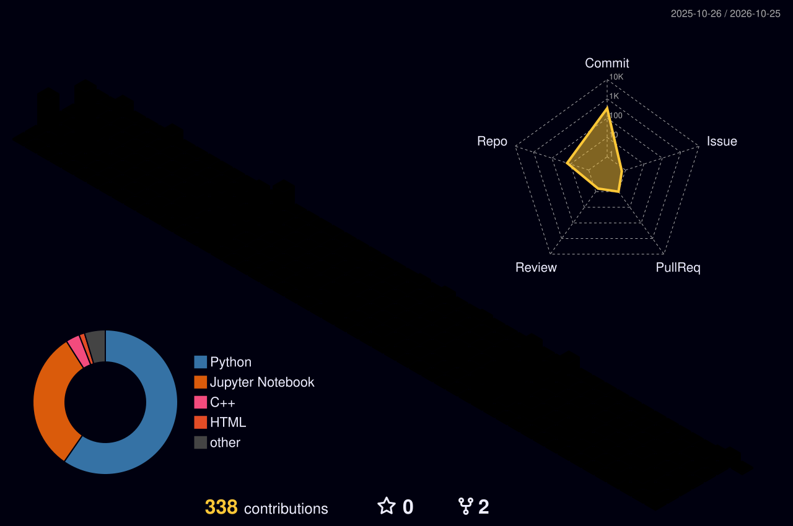

<!--
╔══════════════════════════════════════════════════════════════════════╗
║  SAHIL DESAI — PROFILE README                                         ║
║  Setup: copy this file into the public repo named sahil1399m.         ║
║  Animated snake + 3D graph need the included GitHub Actions files.    ║
╚══════════════════════════════════════════════════════════════════════╝
-->

<!-- ========================= HERO / ANIMATED HEADER ========================= -->

  
   
  
    
  
  
  
  
    
  
  
  

<!-- ============================== QUICK PITCH =============================== -->

I build intelligent systems at the intersection of machine learning, computer vision, and AI engineering.

Currently exploring how models, retrieval systems, and autonomous workflows can become reliable applications—not just demos.

<!-- ================================ NAVIGATION ============================== -->

  <a href="#-about-me">ABOUT</a> ·
  <a href="#-featured-builds">PROJECTS</a> ·
  <a href="#-arsenal">TECH STACK</a> ·
  <a href="#-github-command-center">ANALYTICS</a> ·
  <a href="#-contribution-universe">CONTRIBUTIONS</a> ·
  <a href="#-connect">CONTACT</a>

<!-- ================================ ABOUT ME ================================ -->
01   /   🧬 About Me
┌──────────────────────────────────────────────────────────────────┐
│  NAME       Sahil Desai                                           │
│  FOCUS      AI Engineering • Machine Learning • Computer Vision   │
│  EXPLORING  Deep Learning • RAG • Agentic AI • LLM Applications   │
│  BUILDING   Practical AI projects, from data pipeline to UI       │
│  MINDSET    Build → Measure → Learn → Improve                     │
└──────────────────────────────────────────────────────────────────┘
- 🧠 Building AI-agent projects and computer-vision systems, including drowsiness and proxy-detection concepts.
- 🔬 Interested in model evaluation, video understanding, retrieval-augmented generation, and multi-agent workflows.
- 🛠️ Enjoy working across the stack: data processing, model logic, APIs, and usable interfaces.
- 🌱 Currently strengthening Machine Learning, Deep Learning, Data Science, and DSA foundations.
- 🤝 Open to meaningful collaboration on applied AI/ML and open-source projects.

  
<b>⚡ A tiny terminal snapshot — click to expand</b>

$ whoami
Sahil Desai

$ current_focus
Computer Vision | AI Agents | RAG | Deep Learning

$ preferred_workflow
Understand -> Prototype -> Evaluate -> Ship -> Iterate

$ philosophy
A useful model is more than a metric: it needs reliable inputs,
measurable performance, and a practical way for people to use it.

<!-- =============================== PROJECTS ================================= -->
02   /   🚀 Featured Builds

  <i>Selected projects across AI engineering, deep learning, computer vision, and local-first automation.</i>

<table>
  <tr>
    <td width="50%" valign="top">
      <h3>🧠 VentureIQ</h3>
      
<b>AI Startup Intelligence Platform</b>

      
Startup research and intelligence workflows powered by corrective retrieval-augmented generation, semantic retrieval, and LLM-based synthesis.

      

        
        
        
        
      

      <a href="https://github.com/sahil1399m/startup-blueprint-ai"><b>↗ View source repository</b></a>
    </td>
    <td width="50%" valign="top">
      <h3>🎭 AIthentic</h3>
      
<b>Video Deepfake Detection</b>

      
Video-level deepfake detection using an EfficientNet-B3 visual feature extractor and Bi-LSTM temporal modelling.

      

        
        
        
      

      
<b>Reported accuracy: 89.88%</b> (use only with matching evaluation results)

      Repository URL not added yet — replace this note once published.
    </td>
  </tr>
  <tr>
    <td width="50%" valign="top">
      <h3>🛡️ Sentinel</h3>
      
<b>Multi-Agent Financial Crime Detection</b>

      
Exploring multi-agent orchestration for structured financial-crime analysis, with LLM-driven workflows and SQL-backed data handling.

      

        
        
        
      

      Repository URL not added yet — replace this note once published.
    </td>
    <td width="50%" valign="top">
      <h3>🧾 BillWise Local</h3>
      
<b>Local-First Invoice Processing</b>

      
Invoice extraction and expense management using OCR, local LLM-assisted field extraction, validation rules, and SQLite persistence.

      

        
        
        
      

      Repository URL not added yet — replace this note once published.
    </td>
  </tr>
</table>

  
<b>🧪 What I care about when building AI systems</b>

   

Layer	Questions I try to answer
Data	Is the dataset representative, clean, and split without leakage?
Models	Is the baseline meaningful, and does the metric match the task?
Retrieval	Are the retrieved chunks relevant, traceable, and sufficient?
Agents	Are tool calls controlled, observable, and useful?
Backend	Are APIs testable, inputs validated, and errors handled?
Product	Can someone understand and use the result?

<!-- ================================ TECH STACK ============================== -->
03   /   🧰 The Arsenal

  <h3>LANGUAGES</h3>
  
    
  <h3>AI / ML / COMPUTER VISION</h3>
  
  
  
  
  
    
  <h3>LLM / RETRIEVAL / AGENTS</h3>
  
  
  
  
  
    
  <h3>BACKEND / APP / TOOLING</h3>
  
  
  
  

Stack rule: badges describe tools I have worked with or am actively exploring—not automatic proof of production-level expertise.

<!-- ============================= GITHUB DASHBOARD =========================== -->
04   /   📡 GitHub Command Center

  
  
   
  
   
  

  
<b>📊 More repository insights</b>

   
  

    
      
    
<b>🏆 Milestones are listed below.</b>

    The public trophy image service is currently unavailable, so this profile avoids embedding a broken image.
  

The activity graph is generated in this repository from public GitHub events. It does not include private activity or claim to be an exact contribution count. Stats and streak cards still depend on external services and can occasionally be delayed or rate-limited.
<!-- ========================== CONTRIBUTION UNIVERSE ========================= -->
05   /   🐍 Contribution Universe

  <h3>THE SNAKE IS HUNGRY.</h3>
  <picture>
    <source media="(prefers-color-scheme: dark)" srcset="https://raw.githubusercontent.com/sahil1399m/sahil1399m/output/github-snake-dark.svg" />
    <source media="(prefers-color-scheme: light)" srcset="https://raw.githubusercontent.com/sahil1399m/sahil1399m/output/github-snake.svg" />
    
  </picture>
   
  First-time setup: run <code>Generate contribution snake</code> from the repository's Actions tab. The workflow creates the <code>output</code> branch and publishes the SVGs.

🌌 3D Contribution Galaxy

  <picture>
    <source media="(prefers-color-scheme: dark)" srcset="./profile-3d-contrib/profile-night-rainbow.svg" />
    
  </picture>
  First-time setup: run <code>GitHub-Profile-3D-Contrib</code> from the repository's Actions tab. The placeholder image is replaced after a successful run.

<!-- ================================ MILESTONES ============================== -->
06   /   🏁 Milestones & Momentum

  <table>
    <tr>
      <td align="center" width="33%">
        <h3>🏆 Hackathon</h3>
        <b>Finalist</b> Lenovo LEAP AI Hackathon 2.0 · 2026
      </td>
      <td align="center" width="33%">
        <h3>🌐 Open Source</h3>
        <b>Merged contribution</b> VJTI CoC repository · Inheritance 2025
      </td>
      <td align="center" width="33%">
        <h3>💻 Problem Solving</h3>
        <b>LeetCode peak: 1497</b> Reported rating: 1465
      </td>
    </tr>
  </table>

  
<b>📚 What I'm currently sharpening</b>

   

- [ ] Deep Learning and model evaluation
- [ ] Temporal modelling for video understanding
- [ ] Reliable RAG pipelines and retrieval evaluation
- [ ] Tool-using AI agents and workflow orchestration
- [ ] DSA and problem-solving consistency
- [ ] Better testing, observability, and deployment for AI applications
  Update these checkboxes as your priorities evolve.

<!-- ============================== CURRENT MODE ============================== -->
07   /   🧪 Current Mode
mission: Build practical AI applications
primary_tracks:
  - Machine Learning
  - Deep Learning
  - Computer Vision
  - Retrieval-Augmented Generation
  - Agentic AI
engineering_principles:
  - Measure before claiming
  - Keep experiments reproducible
  - Prefer clear architecture over unnecessary complexity
  - Make the result useful to a real person
status: Always learning; always iterating
<!-- ================================ CONNECT ================================= -->
08   /   🤝 Let's Build Something

  
If you're working on <b>AI/ML, computer vision, intelligent agents, or open source</b>, let's connect and build something useful.

  
  
    
  
    
  

<!-- Built with curiosity, shipped with iteration. -->
